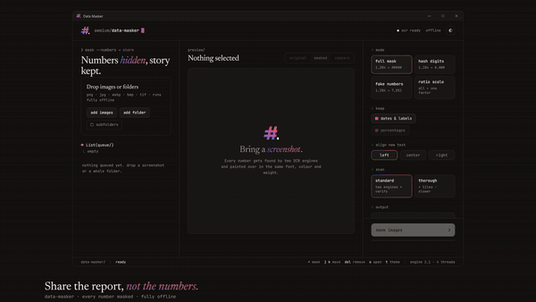
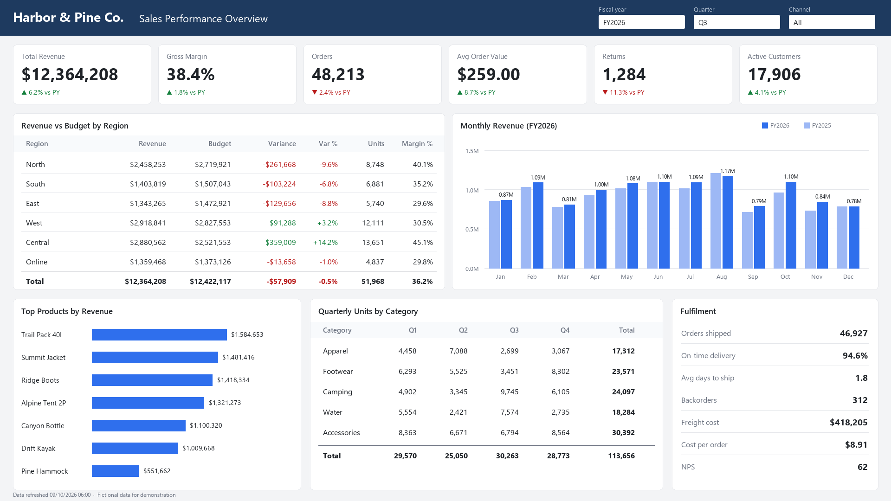

# data-masker

Masks every number in screenshots so they can be shared. Runs fully offline, nothing is uploaded.

A 26 second tour: drop a report in, pick a mode, mask it, then drag the compare slider. [Watch the full-resolution MP4](docs/showcase/showcase.mp4).

| before | after (hash mode) |
|---|---|
|  |  |

The report is fictional (`samples/make_showcase.py` draws it). Windows 10 or 11 and Python 3.10+.

Two OCR engines read each image, because neither catches everything alone:

- RapidOCR (PaddleOCR models on ONNX, bundled in the package) reads digits reliably, but returns whole lines that are split into numbers by estimate.
- Windows OCR (Windows.Media.Ocr) gives exact word boxes, but skips many table cells and only reads a band of text sizes, so it runs at several scales.
- After masking, Windows OCR reads the result again (up to 2 rounds) and masks anything it can now see.

Expect about 5-10 s for a full-screen report screenshot once the engine is warm (the app warms it at launch). It runs below normal priority on at most 4 cores, so the rest of the PC stays responsive.

## App

- `app.pyw` is a pywebview window (Edge WebView2) over `ui/index.html`, styled in the Awmium language: dark by default, `t` toggles light.
- Keys: enter mask, j / k move, del remove, o open output, 1 / 2 / 3 original, masked, compare.
- Settings persist in `%LOCALAPPDATA%\awmium\data-masker\settings.json`.
- Logo: `assets/make_logo.py` draws `mark.svg`, `icon.svg`, `icon.png`, `icon.ico`.

## Run

- Window: double-click `Data Masker.lnk` (or `Data Masker.bat`). Close and reopen it after any code change: a running window keeps the engine it started with; the status bar shows the engine version.
- CLI: `python datamask.py <images or folders> --mode fake|hash|full|ratio [--factor 0.73] [--out DIR] [--align left|center|right] [--thorough] [--recursive] [--mask-dates] [--scale-percent]`

## Modes

| Mode | Example | Use when |
|---|---|---|
| Fake | 1,284 → 7,051 | Realistic-looking demo shots. The same number gets the same fake within a run. |
| Hash | $1,284.50 → $#,###.## | You want the format visible but no digits |
| Full | $1,284.50 → ######### | Nothing about the value may leak |
| Ratio | every number × one factor | Charts and totals must still make sense relative to each other |

## Output

- No destination chosen: `<source folder>\Masked - <source folder name>\Masked - <file name>`
- Destination chosen: `<destination>\Masked - <file name>`
- Files and folders starting with `Masked - ` are skipped when a folder is added again.

## Defaults worth knowing

- Dates, years, times and labels like Q1 / FY26 are kept. Untick to mask them as well.
- In ratio mode, percentages are kept, because scaling every value by the same factor leaves shares and growth rates unchanged.
- Thorough scan adds more scales, an inverted pass for dark themes and overlapping tiles. Slower; use it when a number slips through.
- Always glance at the preview before sharing. OCR can miss tiny or stylised text.

## Showcase

`docs/showcase/showcase.html` is the tour above, built from the app's own interface and the fictional report. Open it in a browser and it loops live: every frame is a pure function of time, so it renders the same way each run. The GIF, MP4 and poster next to it are exports of that page. Its fonts (Newsreader, Plus Jakarta Sans, JetBrains Mono) are under the SIL Open Font License, as noted in `ui/fonts/FONTS.md`.

## Setup (once per machine)

`pip install winrt-runtime winrt-Windows.Media.Ocr winrt-Windows.Globalization winrt-Windows.Graphics.Imaging winrt-Windows.Storage.Streams winrt-Windows.Foundation winrt-Windows.Foundation.Collections pillow numpy rapidocr_onnxruntime pywebview`

## License

MIT. Built by [Awmium](https://awmium.com).
